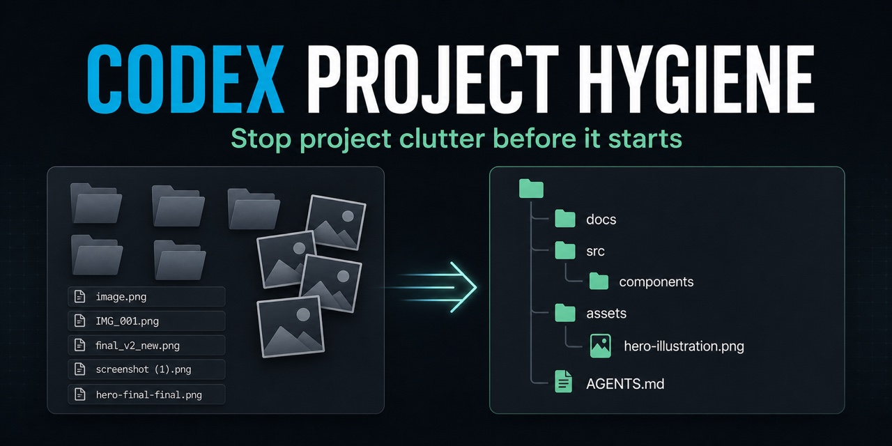

# Codex Project Hygiene

[](https://github.com/kotyasmol/codex-project-hygiene/actions/workflows/ci.yml)
[](https://github.com/kotyasmol/codex-project-hygiene/releases)
[](LICENSE)
[](https://www.python.org/downloads/)



**A preventive Codex skill that installs persistent project instructions before
development starts—so later tasks create fewer directories, keep temporary
iterations outside the repository, and give durable artifacts meaningful names.**

Most cleanup tools arrive after a workspace has already become a landfill. This
skill starts earlier: it adds one reviewed block to the project's root
`AGENTS.md`. Codex then discovers the rules in later tasks without requiring the
skill to be invoked for every change.

Cleanup helpers for existing projects remain available as an explicit secondary
mode. They are not activated by project bootstrap.

This is an independent community project and is not an official OpenAI product.

## Before and after

Without persistent project guidance, a sequence of otherwise reasonable tasks
can leave behind this kind of structure:

```text
project/
├── temp-output/
├── screenshots-new/
├── generated-images/
│   ├── image.png
│   ├── final_v2_new.png
│   └── final-final.png
└── experiment-3/
```

Bootstrap once. Future tasks discover the managed rules in `AGENTS.md` and keep
scratch outside the repository:

```text
project/
├── AGENTS.md
├── src/
└── assets/
    └── onboarding-dashboard-mobile.png

/tmp/<task-scoped-scratch>/   # downloads, renders, rejected candidates
```

The bootstrap does not reorganize the project or delete anything. It previews
one exact `AGENTS.md` change and applies it only after approval.

## What changes after bootstrap

Future Codex tasks are instructed to:

- inspect and reuse the established project layout before creating paths;
- create a directory only for a real toolchain requirement or a coherent group
  of durable deliverables;
- keep downloads, experiments, renders, captures, and rejected candidates in
  one task-scoped temporary directory outside the repository;
- generate one media candidate by default and iterate on it unless alternatives
  were requested;
- copy only selected deliverables into the project;
- use semantic names such as `onboarding-dashboard-mobile.png` instead of
  `final-2.png`, `result-new.png`, timestamps, hashes, or raw prompt fragments;
- report the durable paths created and remove only scratch from the current task.

The policy respects user-requested paths, repository conventions, and standard
tool-managed directories. It never authorizes reorganizing or deleting existing
content.

## Install the skill

Recommended: ask Codex to install the skill directly from GitHub:

```text
Use $skill-installer to install:
https://github.com/kotyasmol/codex-project-hygiene
```

Or install it manually:

```bash
git clone https://github.com/kotyasmol/codex-project-hygiene.git \
  "$HOME/.agents/skills/codex-project-hygiene"
```

Restart Codex and begin a new task if the skill is not visible immediately.
The repository itself is the skill directory; `SKILL.md` must remain at its
root. OpenAI describes skills as reusable workflows built around a `SKILL.md`
playbook in its [skills overview](https://help.openai.com/en/articles/20001066).

Review the source and revision before installing any skill that can modify
project instructions or files.

Runtime requirements are Python 3.9 or newer and Git. There are no third-party
Python dependencies and no runtime network calls or telemetry.

## Bootstrap a new project

At the beginning of development, ask:

```text
Use $codex-project-hygiene to bootstrap this project. Preview the exact
project-level AGENTS.md change, preserve existing instructions, and install it
after I approve the target, diff, and fingerprint. Do not create anything else.
```

The skill first runs a non-mutating preview:

```bash
python3 scripts/install_policy.py preview \
  --root /path/to/project \
  --format terminal
```

Preview shows the exact `AGENTS.md` target, action, unified diff, and approval
token. After approval:

```bash
python3 scripts/install_policy.py apply \
  --root /path/to/project \
  --confirm APPROVAL_TOKEN
```

The installer changes only the root `AGENTS.md`. It preserves unrelated bytes,
owns only one explicitly marked block, performs an atomic replacement, and
rejects symlinks, broad roots, malformed markers, invalid UTF-8, oversized
instruction files, or a stale fingerprint. It creates no config directory,
backup, policy database, report, or daemon.

Installing the skill alone is not enough: skills are selected per task. The
bootstrap step is what makes the guidance persistent for that project.

## Why the safety model is reviewable

The prevention workflow is intentionally small:

1. `preview` prints the exact target, diff, and fingerprint without writing.
2. Approval binds the project root, current `AGENTS.md`, and proposed content.
3. `apply` revalidates that fingerprint and owns only its marked block.
4. A second bootstrap updates the same block instead of duplicating it.

There is no daemon, telemetry, global configuration change, background cleanup,
or runtime network request. The runtime uses only Python's standard library.

## The installed policy

The maintained source is
[`assets/AGENTS.project-hygiene.md`](assets/AGENTS.project-hygiene.md). The
installer surrounds it with:

```html
<!-- codex-project-hygiene:start -->
...
<!-- codex-project-hygiene:end -->
```

Running bootstrap again updates that block without duplicating it. Conflicting,
missing, or duplicate markers fail closed for manual review. See
[instruction precedence and removal](references/workspace-hygiene.md).

## Audit an existing messy project

The read-only audit examines names and directory metadata without reading file
contents or writing a report file:

```bash
python3 scripts/hygiene_audit.py \
  --root /path/to/project \
  --format terminal
```

It can highlight persistent scratch trees, project-local package stores,
iteration families, opaque names, and excessive root artifacts. Every finding
has unknown origin and zero confirmed reclaimable bytes. A filename does not
prove that Codex created it or that it is safe to remove.

## Optional cleanup for existing data

Only an explicit cleanup request activates these tools:

- `scripts/cleanup.py` inventories bounded dependency trees, build outputs, and
  developer caches;
- `scripts/media_cleanup.py` creates a bounded local review gallery for exact
  generated-image selection.

Cleanup requires a sealed plan, visible exact IDs, an operation-bound token,
and either Trash or permanent mode. Trash is recommended; permanent deletion
requires a separate no-recovery acknowledgement. Tracked files, repositories,
symlinks, mount boundaries, deliverable trees, and protected Codex state cannot
be selected.

Visual similarity and exact duplication only create review groups. They never
select an image. Codex currently exposes no dependable machine-readable
accepted/rejected flag, so the skill cannot safely delete rejected images in the
background or prevent the application from retaining history.

## Safety boundary

- Project bootstrap never implies cleanup permission.
- The policy installer writes only the exact project-level `AGENTS.md`.
- Existing files are never renamed, moved, or deleted to enforce neatness.
- Cleanup scans reject `/`, a home directory, broad ancestors, and all of
  `CODEX_HOME`.
- Cleanup never edits Codex sessions, JSONL history, SQLite/WAL state, task
  locks, configuration, installed skills, or plugins.
- Cleanup uses no `rm -rf`, `git clean`, wildcard selection, force flag,
  privilege escalation, or copy-and-delete Trash fallback.

Read the [safety contract](docs/SAFETY.md),
[threat model](docs/THREAT-MODEL.md), and
[recovery guide](docs/RECOVERY.md) before enabling cleanup. Cleanup support is a
safety-first beta, not a promise of zero risk.

## Platform status

The policy installer uses standard-library Python and is tested with synthetic
fixtures. The metadata audit and cleanup tools remain deliberately narrower:

| Platform | Policy bootstrap | Hygiene audit | Cleanup apply |
|---|---:|---:|---:|
| macOS | Yes | Yes | Experimental beta |
| Linux | Yes | Yes | Experimental beta |
| Windows | Implemented, not yet CI-certified | Hard-disabled in this beta | Hard-disabled |

No platform support claim is final until the public CI matrix is green.

## Development

```bash
python3 -m unittest discover -s tests -v
python3 -m py_compile scripts/*.py tests/*.py
```

Contributions should use only synthetic fixtures and must preserve the
default-deny boundaries. See [CONTRIBUTING.md](CONTRIBUTING.md) and
[SECURITY.md](SECURITY.md). General help belongs in [SUPPORT.md](SUPPORT.md),
and community participation follows [CODE_OF_CONDUCT.md](CODE_OF_CONDUCT.md).

## License

[MIT](LICENSE)
